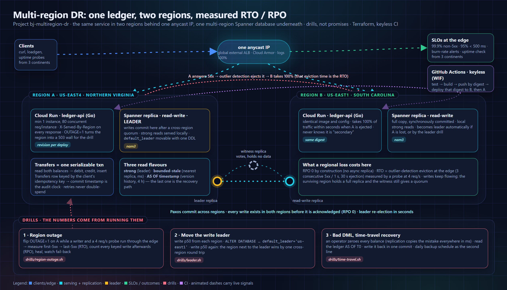

# Multi-region DR on Google Cloud: one ledger, two regions, measured RTO / RPO

[](demo/demo.mp4)

`ledger-api` (Go) runs identically in **two regions** (`us-east4`, `us-east1`) on **Cloud Run**, behind **one
anycast IP** (global external Application Load Balancer, Cloud Armor, 100% request logging), on top of **one
multi-region Cloud Spanner database** (`nam3`: both regions hold a synchronously committed read-write replica, a
witness in a third region breaks ties). A regional outage changes *where* requests are served, never *what* the
ledger says: **RPO 0 by construction**, and the **RTO is the load balancer's outlier-detection eviction time**,
which the drills measure instead of estimating. Transfers are serializable Spanner transactions keyed by a client
idempotency key, so retries across a failover never double-spend. Reads come in three flavours: strong,
bounded-stale (nearest replica) and **AS OF a past timestamp**, which is also how a bad DML is undone in seconds.
Terraform for every resource; keyless CI that rolls the same digest to both regions one at a time.

- Demo video: [`demo/demo.mp4`](demo/demo.mp4) · captions [`demo/captions.srt`](demo/captions.srt) · transcript [`demo/transcript.md`](demo/transcript.md)
- Docs site: [`docs/index.html`](docs/index.html) · drills: [`drills/`](drills/) · load generator: [`loadgen/load.py`](loadgen/load.py)
- Project: `bj-multiregion-dr` · regions `us-east4` + `us-east1` · Spanner config `nam3` (100 processing units)
- **Rebuild from scratch, step by step, with the gotchas: [`REBUILD.md`](REBUILD.md)**

## The three drills (`drills/`)

| Drill | What it does | What it measures |
|---|---|---|
| `region-outage.sh` | flips `OUTAGE=1` on the us-east4 revision (every request there answers 503) while a keyed writer (1/s) and an edge probe (4/s) run; heals it 35 s later | **RTO**: first 5xx → last 5xx at the edge (outlier detection: 3 consecutive 5xx in 1 s ejects the region for 30 s); **RPO**: every keyed write present exactly once, `total_balance` unchanged |
| `leader.sh` | measures write p50 from each region's Cloud Run URL, moves the Spanner leader with `ALTER DATABASE ledger SET OPTIONS (default_leader='us-east1')`, measures again | the cost of one cross-region round trip on every commit, and that the leader is a dial you can turn |
| `time-travel.sh` | an operator runs `UPDATE Accounts SET Balance = 0 WHERE TRUE`; the service reads the ledger `AS OF` a timestamp before it and writes it back in one commit | recovery in seconds from Spanner's version history (4 h retention here, up to 7 d), no backup restore needed; a daily backup schedule is the second line |

`loadgen/load.py` runs 20 concurrent keyed transfers through the edge and checks the invariant afterwards: money
moves, it is never created, so `total_balance` is unchanged and `transfers` grew by exactly the number of 201s.

## What is where

```
app/            Go service: strong / stale / AS-OF reads, idempotent transfers, OUTAGE knob, admin restore; tests
terraform/      Spanner (nam3, DDL, version retention, backup schedule), Cloud Run x2, serverless NEGs, global LB with
                outlier detection + Cloud Armor, SLOs on LB metrics, burn-rate alerts, uptime check, dashboard, WIF/CI SA
drills/         probe.sh, region-outage.sh, leader.sh, time-travel.sh
loadgen/        load.py (concurrency + invariant check)
.github/        release.yml: test -> build -> push by digest -> deploy B then A, keyless
deploy.sh       bring-up (registry -> image v1 -> everything -> seed -> smoke); `deploy.sh image TAG` rolls a new image
smoke.sh        one IP, two regions, one ledger, idempotent retry, current default leader
teardown.sh     destroy + leftovers + billing audit;  reimport.sh for the rebuild;  audit-billing.sh
docs/           index.html (GitHub Pages), architecture.html (live diagram), architecture.png
demo/           scenes.py + recorder.py (narrated demo), demo.mp4, captions, transcript
```

## SLOs (edge metrics, so a failover is judged the way a user sees it)

- **Availability** 99.9% of requests non-5xx (`loadbalancing.googleapis.com/https/request_count`, 28 d rolling)
- **Latency** 95% under 500 ms backend latency (`https/backend_latencies`)
- Fast (1 h > 14.4×) and slow (6 h > 6×) burn-rate alerts, an uptime check from three continents, and a dashboard
  with requests and 5xx **by serving region**, p95 by region, Cloud Run instances by region, Spanner CPU and API latency.

## Cost while it runs

Spanner `nam3` at 100 processing units (Enterprise edition, needed for `default_leader`) is the only idle cost,
roughly US$0.45/hour; Cloud Run min-instances and the LB add cents. `./teardown.sh` removes everything and runs the
billing audit.
